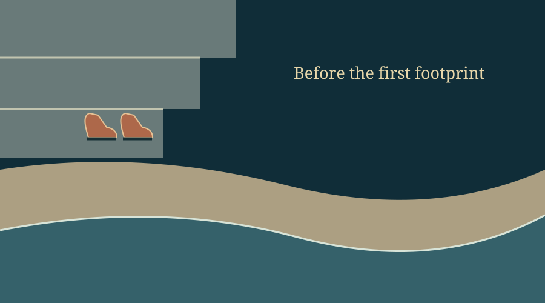
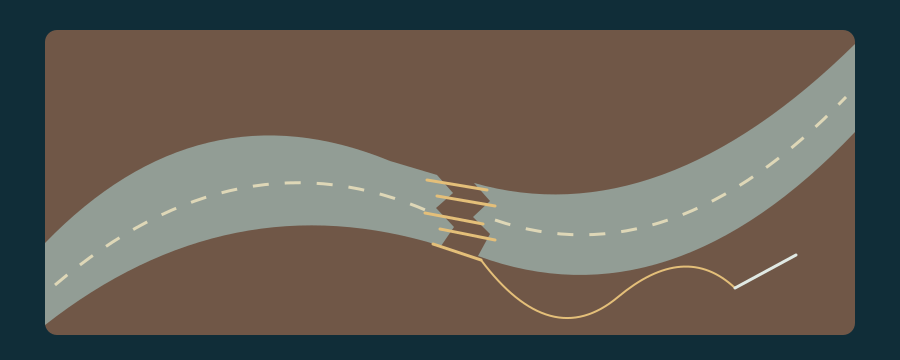

# The road remembers your feet

With `webshore.py` running, [walk this route in the browser](http://127.0.0.1:8000/barefoot.html).

At the lowest step, a child asks what was here before anyone arrived.
The oldest shell is waiting under the water.

Type `read 23` to [walk with the child](stories/FIRST_FOOTPRINT.md).
At low water, the shell comes within reach; `tidetable` tells you when.
The child leaves their shoes behind.

The shoes need nothing.
The road has worn through.

Type `read 24` to [visit the repair shop](stories/SHOE_REPAIR.md).
Choose a destination for the lamp. Step outside barefoot.
