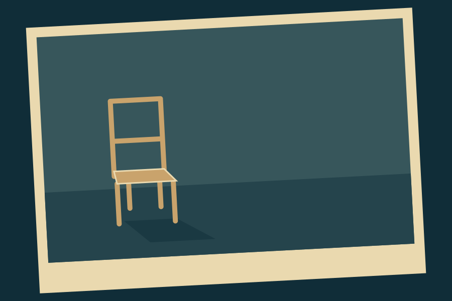

# The paper remembers

Type `read 33` to [sit for the photographer](stories/PHOTOGRAPHER.md).
There is room in the picture for what is missing.

Then `read 34` to [enter the darkroom](stories/DARKROOM.md).
Open each postcard when the photographer asks. The next exposure will replace it.

Finally, `read 35` to [visit the bookbinder](stories/BINDERY.md).
Open the book and find a line worth folding a corner for.

