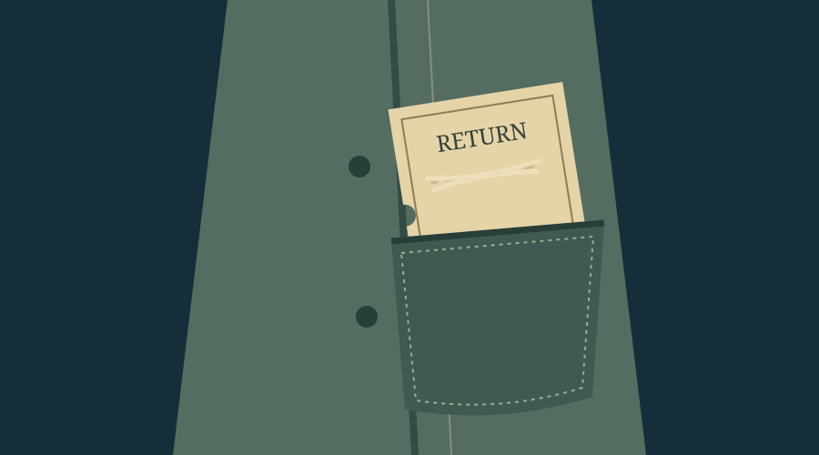
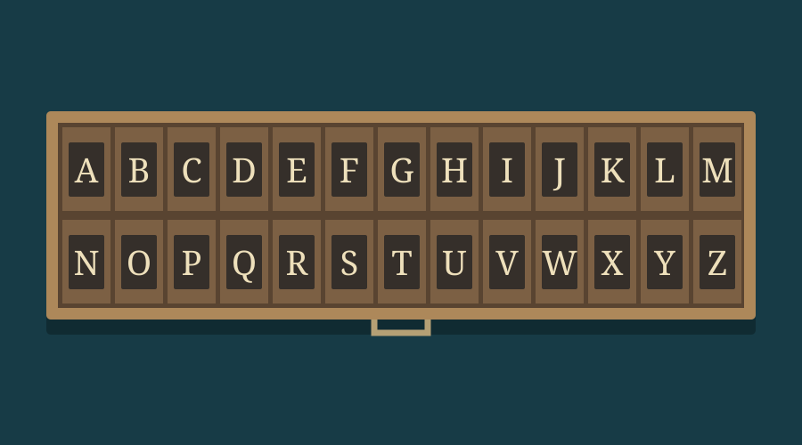

# A ticket without a station

Type `read 37` to [check your pockets](stories/CLOAKROOM.md).
The poem is your claim ticket.

[Alice's ticket](exhibits/claim-ticket/README.md) had forgotten its station.
It still knew how to listen.

Then `read 36` to [visit the mapmaker](stories/MAPMAKER.md).
She begins with MAZE. At her final pause, try `spell HOME`, or give her
another destination. Open `jetty.svg` to see which remembered lines carry it.
A bare letter is a place the shore has yet to fill.

Keep the map with the ticket. There is room in the pocket for both.
