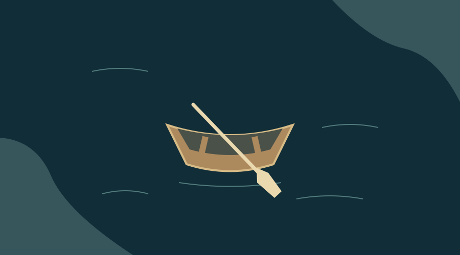

# The other bank

Type `read 31` to [go down to the slipway](stories/SLIPWAY.md).
The timetable belongs to the water. At low tide, you can reach the oldest shell.

Then `read 32` to [take the ferry](stories/FERRY.md).
Your fare is the last thing the sea said.

Both hands stay in the air as the boat turns.
From either bank, it looks like someone else is going home.

[Alice waved.](exhibits/here-too/README.md) [Bob waved back.](exhibits/both-hands/README.md)
