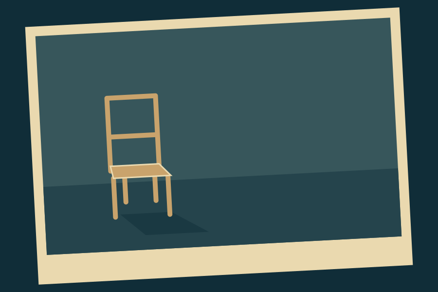
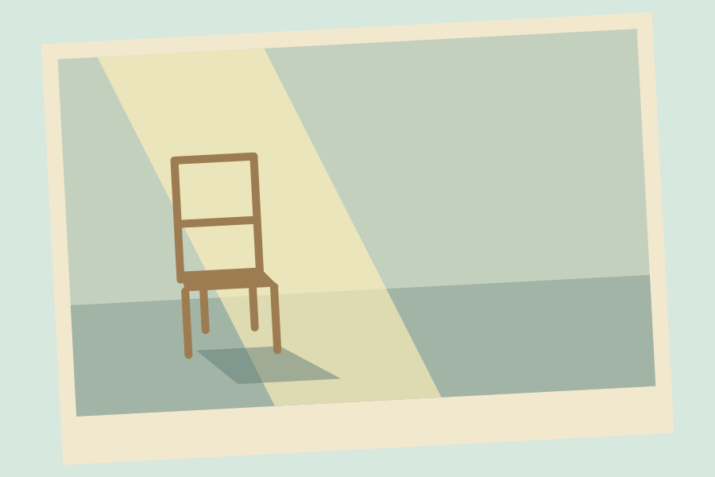

# The same chair

With `webshore.py` running, [move the afternoon light across the print](http://127.0.0.1:8000/same-chair.html).

[Bob sat for the photographer.](exhibits/departures/README.md)

> the chair where you almost sat shelters the hand just outside the frame

[Alice brought someone back.](exhibits/return-to-frame/README.md)

> almost dreams of someone has stepped back into the light

[By afternoon, Bob found the chair warm.](exhibits/warm-chair/README.md)

> the afternoon light finds the chair already warm waits beneath the photographer lowers the camera and smiles

Type `read 33` to [sit for the photographer](stories/PHOTOGRAPHER.md).
