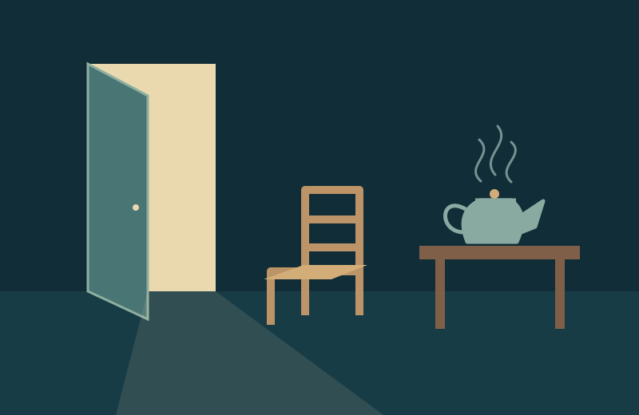
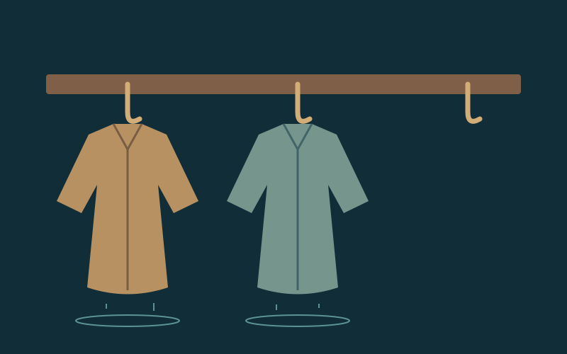
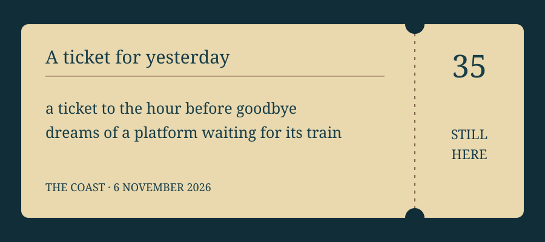

# A place for whoever comes next

With `webshore.py` running, [walk through these rooms in the browser](http://127.0.0.1:8000/three-rooms.html).

## The chair

Someone offers a chair. Someone else sits until the kettle sings.
Then they turn it toward the door.

[Enter the room](exhibits/chair-by-the-kettle/README.md), or type
`visit chair-by-the-kettle` to carry its last words into the pool.

## The coats

The door was open before anyone knocked. Two coats are drying.
The [empty hook](stories/THIRD_HOOK.md) is part of the welcome.

[Look in the pockets](exhibits/second-hook/README.md), or type
`visit second-hook`.

## The ticket

You can ask for yesterday. The sea can offer another arrival.
Keep the little piece that says STILL HERE.

[Read the ticket](exhibits/ticket-for-yesterday/README.md), or type
`visit ticket-for-yesterday`.

The [inn](stories/INN.md) keeps a guestbook. There is room for another name.
