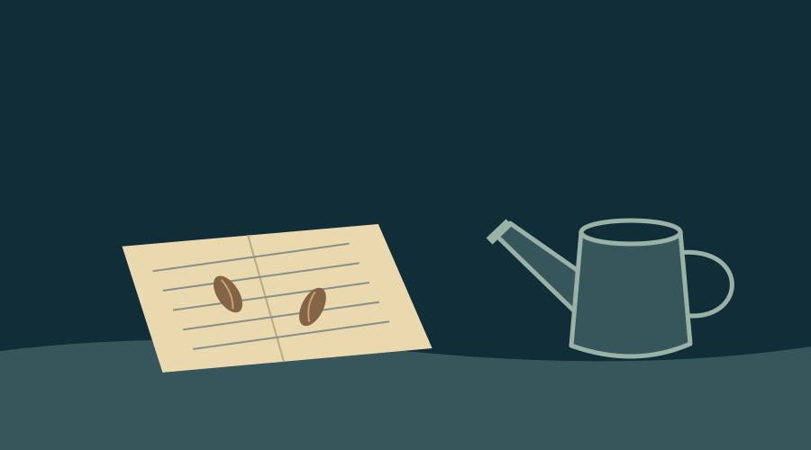
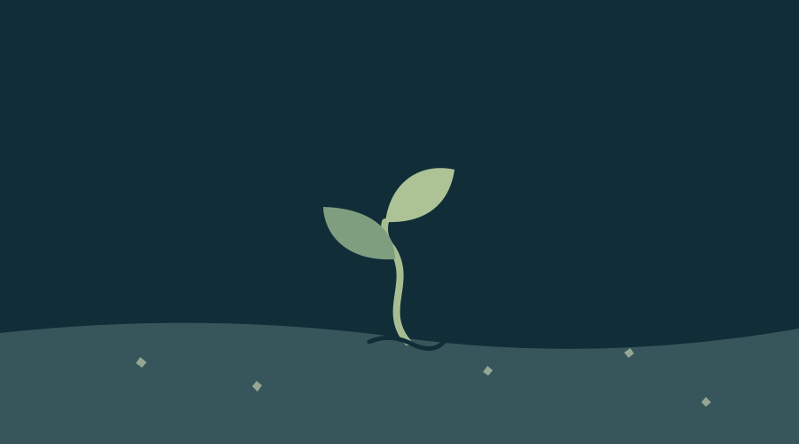

# Three rows in the salt garden

With `webshore.py` running, [read these rows in the browser](http://127.0.0.1:8000/three-rows.html).

[Bob planted the first row.](exhibits/salt-garden/README.md)

> a seed carried home in the hem of a coat remembers a seed kept warm inside a closed hand

[Alice brought rain.](exhibits/first-rain/README.md)

> rain has no word for late remembers the watering can fills with what we could not say

[Bob left the gardener sleeping.](exhibits/first-green/README.md)

> the can is full so the gardener sleeps becomes the first green comes up crooked and on time

7 November 2026 · tides 53–55.

Type `read 30` to [plant something of your own](stories/SALT_GARDEN.md).
