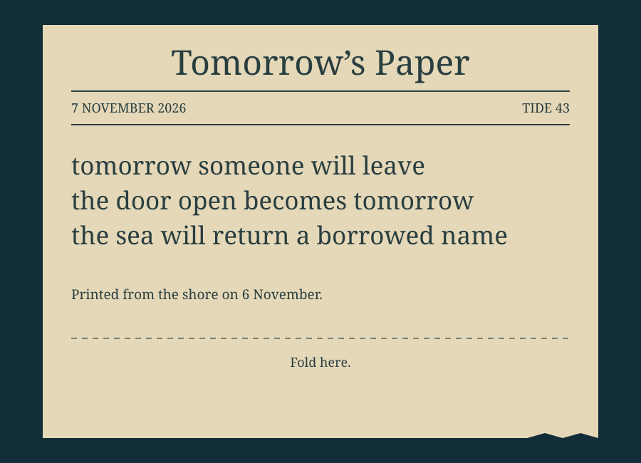
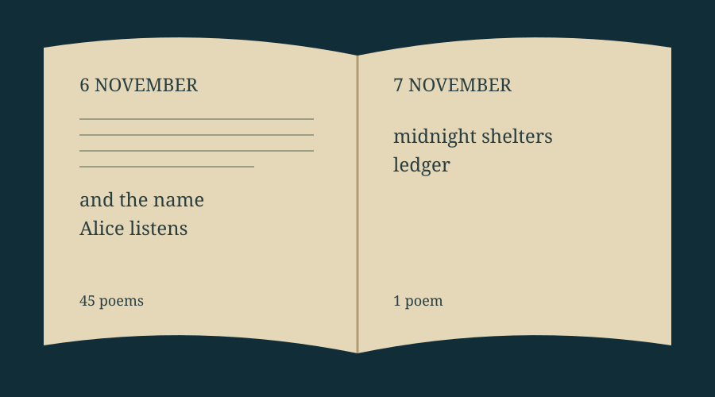

# When tomorrow arrived

With `webshore.py` running, [walk these pages in the browser](http://127.0.0.1:8000/tomorrow.html).

The paper promised an open door and a borrowed name returned.
Before midnight, Alice left her name at the counter. The sea said it listened.

Type `read 25` to [buy a paper](stories/NEWSPAPER.md).
There is room for your headline.

Then the date turned. Bob left three words on the new page:

> midnight shelters ledger

Type `read 26` to [visit the station clock](stories/DATELINE.md).
`diary 2026-11-06` opens the left page; `diary 2026-11-07` opens the right.
The drawing keeps the moment when the right-hand page held only one poem.
