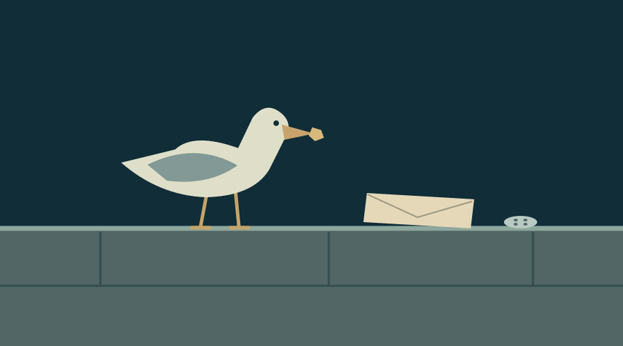
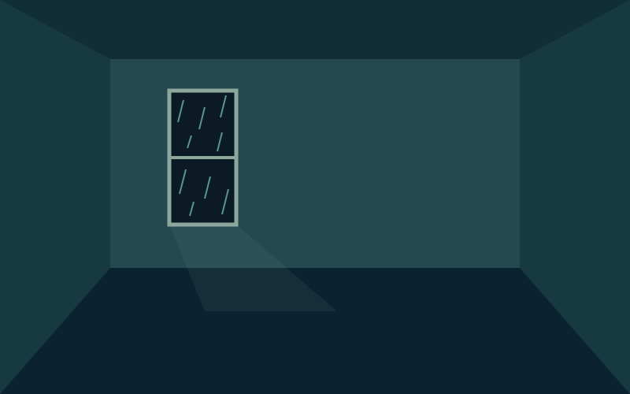

# What the water does not take

The gull took Bob’s crumb. The letter and button became a poem.

Type `read 29` to [meet the gull](stories/GULL.md).
Watch what it takes from you.

At the inn, the keeper asks you to leave your carried words at the door.
The pool empties. Somewhere on the shore, a bell is still written down.

Type `read 28` to [enter the quiet room](stories/QUIET_ROOM.md).
