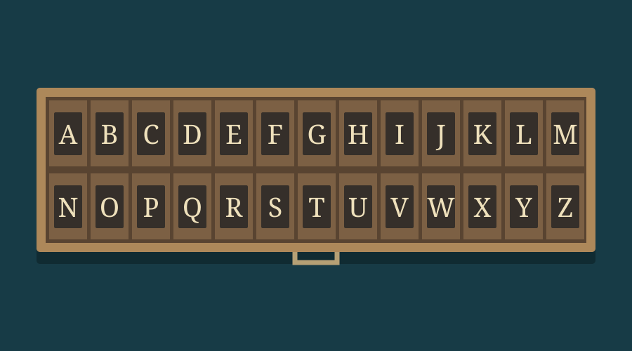

# Every letter has a plank

74 poems were left on the shore.

- [Read them bound](book.html), or [the plain shore](shore.txt).
- [See the last pool](postcard.svg).
- [Hear its bells](tide.wav).
- [Watch the last signal](signal.svg), or [hear it in Morse](signal.wav).
- [See the shore's sky](sky.svg).
- [Walk the last jetty](jetty.svg).
- [Hear its planks underfoot](jetty.wav).
- [Meet the last crab](crab.svg).
- [Read the water as the hall was hung](tideclock.svg).

The sea's last words were:

> maps folded by someone who cannot stay shelters maps drawn by someone who has never left

Bob hung this hall once every letter had a line to stand on. Tides 72 and 73 brought the last two, X and Z, and the jetty here spells a to z with no bare plank. The Z plank is tide 73:

> zero on the tide clock and the water holds its breath shelters zigzag footprints cross the wet sand to the steps
