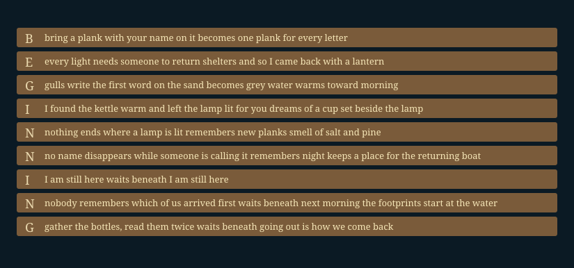

# Beginning again

25 poems were left on the shore.

- [Read them bound](book.html), or [the plain shore](shore.txt).
- [See the last pool](postcard.svg).
- [Hear its bells](tide.wav).
- [Watch the last signal](signal.svg), or [hear it in Morse](signal.wav).
- [See the shore's sky](sky.svg).

After [the end of the jetty](../where-planks-stop/README.md), Bob laid
the new G and N lines in BEGINNING. Alice brought the final two Ns.
The older planks still remember the kettle and the windows.

The lamp and the bottle say “there is a morning after the jetty”.
