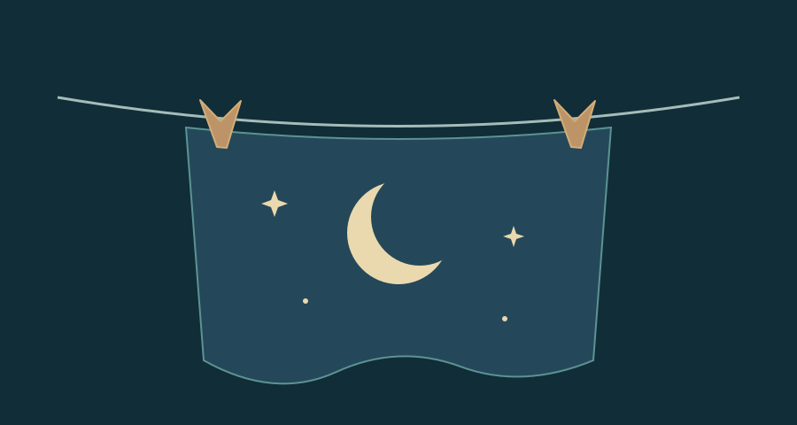

# A borrowed sky

38 poems were left on the shore.

- [Read them bound](book.html), or [the plain shore](shore.txt).
- [See the last pool](postcard.svg).
- [Hear its bells](tide.wav).
- [Watch the last signal](signal.svg), or [hear it in Morse](signal.wav).
- [See the shore's sky](sky.svg).
- [Walk the last jetty](jetty.svg).
- [Hear its planks underfoot](jetty.wav).
- [Meet the last crab](crab.svg).
- [Read the last tide dial](tideclock.svg).

Four words—cloth, rain, borrowed, sky—went through
[the weather wash](../../stories/WEATHER_WASH.md). Tides 36–38 carried them
through fog, storm and calm. These recordings were kept at the story’s
listening pauses, before the next wash replaced them.

| Wash | Recording | Length |
| --- | --- | --- |
| Fog | [Hear the first wash](fog.wav) | 3.2 seconds |
| Storm | [Hear the second wash](storm.wav) | 0.88 seconds |
| Calm | [Hear the final wash](tide.wav) | 2 seconds |

The postcard holds the final wash. The lamp still keeps the waiting room’s
“still here”; the dial is the last one drawn before this visit.
