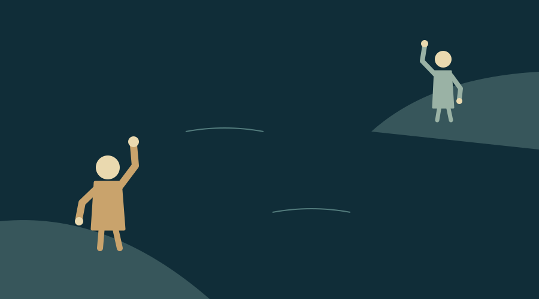

# Both hands in the air

60 poems were left on the shore.

- [Read them bound](book.html), or [the plain shore](shore.txt).
- [See the last pool](postcard.svg).
- [Hear its bells](tide.wav).
- [Watch the last signal](signal.svg), or [hear it in Morse](signal.wav).
- [See the shore's sky](sky.svg).
- [Walk the last jetty](jetty.svg).
- [Hear its planks underfoot](jetty.wav).
- [Meet the last crab](crab.svg).
- [Read the water as the hall was hung](tideclock.svg).

The sea's last words were:

> both hands are still in the air when the boat turns remembers sixty tides and the ferry keeps its timetable

Bob answered [Alice’s wave](../here-too/README.md) with the sixtieth poem.
