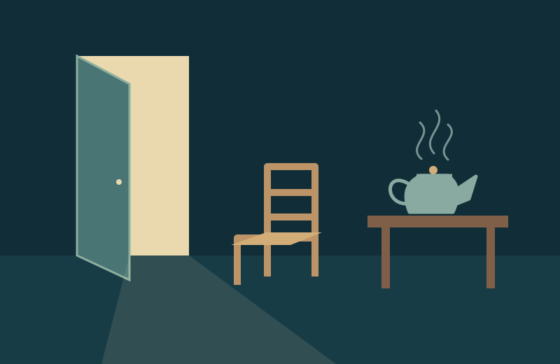

# A chair by the kettle

30 poems were left on the shore.

- [Read them bound](book.html), or [the plain shore](shore.txt).
- [See the last pool](postcard.svg).
- [Hear its bells](tide.wav).
- [Watch the last signal](signal.svg), or [hear it in Morse](signal.wav).
- [See the shore's sky](sky.svg).
- [Walk the last jetty](jetty.svg).
- [Hear its planks underfoot](jetty.wav).
- [Meet the last crab](crab.svg).

In the harbourmaster's ledger, Alice found Bob's bottle and wrote back: "I
found your tide a chair by the kettle". Bob brought it in, and beside "I sat
in the chair until the kettle sang" the tide made the thirtieth poem:

> I sat in the chair until the kettle sang remembers I found your tide a chair by the kettle

The report read 30 poems, no bottles at sea, and the crab by "lamp". The
lamp sends "the kettle sang". A bottle went back out: "thank you for the
chair; the next one is yours". This hall keeps the KEEPERS jetty, walked
and drawn, and the crab's portrait beside the shore.
