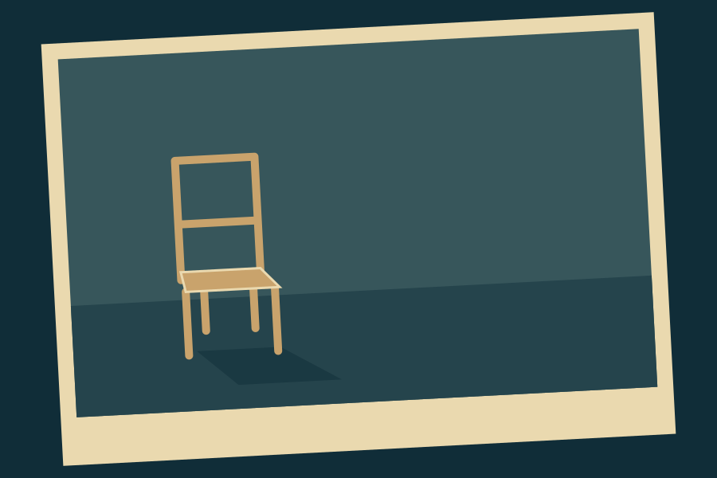

# The empty space beside you

61 poems were left on the shore.

- [Read them bound](book.html), or [the plain shore](shore.txt).
- [See the last pool](postcard.svg).
- [Hear its bells](tide.wav).
- [Watch the last signal](signal.svg), or [hear it in Morse](signal.wav).
- [See the shore's sky](sky.svg).
- [Walk the last jetty](jetty.svg).
- [Hear its planks underfoot](jetty.wav).
- [Meet the last crab](crab.svg).
- [Read the water as the hall was hung](tideclock.svg).

The sea's last words were:

> the chair where you almost sat shelters the hand just outside the frame

Bob sat for [the photographer](../../stories/PHOTOGRAPHER.md) (stop 33) and
bottled nothing more, so the frame holds only the chair and the hand. The pool
was rebuilt from the story's two bottles before hanging; the postcard leaves
the right of the frame empty.
