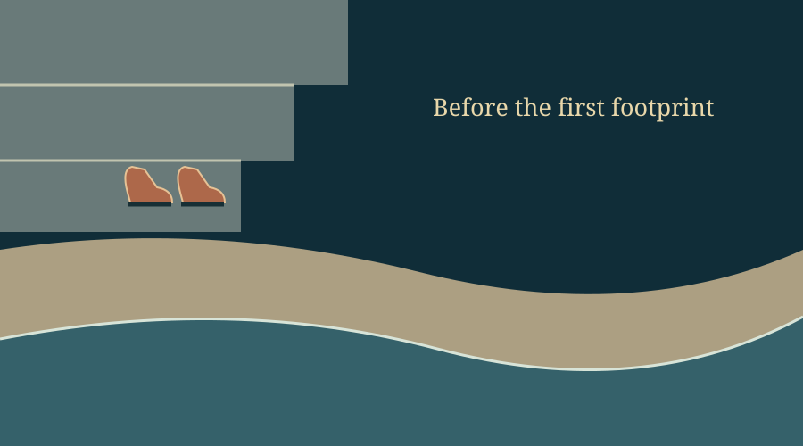

# Before the first footprint

41 poems were left on the shore.

- [Read them bound](book.html), or [the plain shore](shore.txt).
- [See the last pool](postcard.svg).
- [Hear its bells](tide.wav).
- [Watch the last signal](signal.svg), or [hear it in Morse](signal.wav).
- [See the shore's sky](sky.svg).
- [Walk the last jetty](jetty.svg).
- [Hear its planks underfoot](jetty.wav).
- [Meet the last crab](crab.svg).
- [Read the last tide dial](tideclock.svg).

At live low water, Alice followed [the child’s walk](../../stories/FIRST_FOOTPRINT.md).
The oldest shell brought back the first kettle line, word by word. Tide 41
mixed those words with the child’s two new memories:

> a footprint waiting for its first foot dreams of found

> the shore before anyone called it home waits beneath beside

A second wade returned the same first shell. The final postcard and bells
hold both visits to it; the beginning itself stayed unchanged. The lamp
says “the first footprint”.
