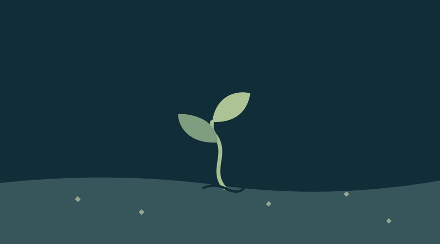

# Crooked and on time

55 poems were left on the shore.

- [Read them bound](book.html), or [the plain shore](shore.txt).
- [See the last pool](postcard.svg).
- [Hear its bells](tide.wav).
- [Watch the last signal](signal.svg), or [hear it in Morse](signal.wav).
- [See the shore's sky](sky.svg).
- [Walk the last jetty](jetty.svg).
- [Hear its planks underfoot](jetty.wav).
- [Meet the last crab](crab.svg).
- [Read the water as the hall was hung](tideclock.svg).

The sea's last words were:

> the can is full so the gardener sleeps becomes the first green comes up crooked and on time

Bob answered [the rain](../first-rain/README.md) with tide 55.
Alice restored the two phrases for the postcard and signalled “sleep well”.
