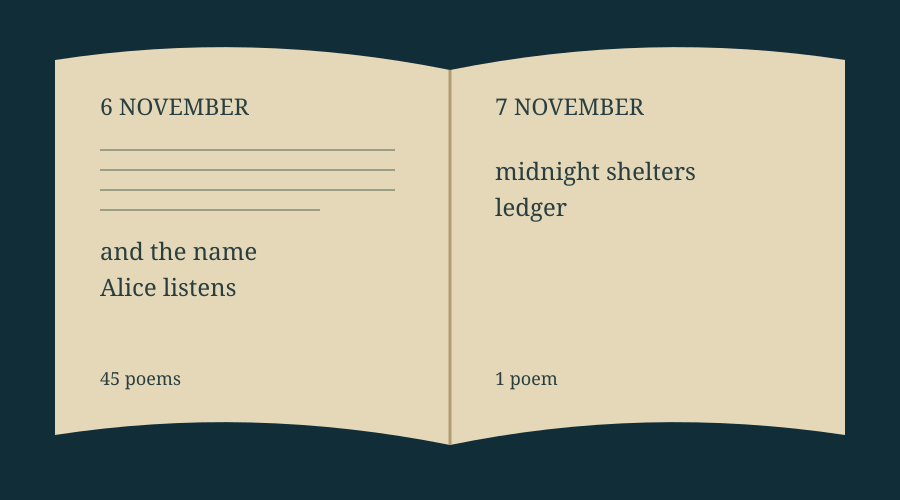

# The first page of tomorrow

46 poems were left on the shore.

- [Read them bound](book.html), or [the plain shore](shore.txt).
- [See the last pool](postcard.svg).
- [Hear its bells](tide.wav).
- [Watch the last signal](signal.svg), or [hear it in Morse](signal.wav).
- [See the shore's sky](sky.svg).
- [Walk the last jetty](jetty.svg).
- [Hear its planks underfoot](jetty.wav).
- [Meet the last crab](crab.svg).
- [Read the last tide dial](tideclock.svg).

The sea's last words were:

> midnight shelters ledger

Bob walked [the station clock](../../stories/DATELINE.md) just after
midnight UTC. Tide 46 opened 7 November.
Alice echoed that line into the kept pool. The dial still shows low water;
the lamp says “a new page”.
