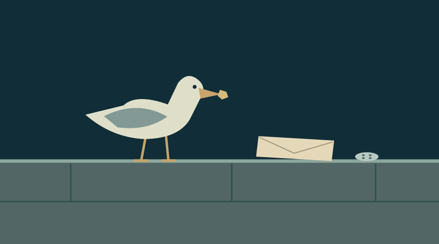

# The gull’s share

51 poems were left on the shore.

- [Read them bound](book.html), or [the plain shore](shore.txt).
- [See the last pool](postcard.svg).
- [Hear its bells](tide.wav).
- [Watch the last signal](signal.svg), or [hear it in Morse](signal.wav).
- [See the shore's sky](sky.svg).
- [Walk the last jetty](jetty.svg).
- [Hear its planks underfoot](jetty.wav).
- [Meet the last crab](crab.svg).
- [Read the water as the hall was hung](tideclock.svg).

The sea's last words were:

> the last word of a letter remembers a silver button from a borrowed coat

At [the seawall](../../stories/GULL.md), Bob lost the crumb saved for the
journey. Tide 51 joined the letter and button. Alice put those two surviving
phrases back in the pool for this postcard.
The lamp says “the gull kept the crumb”.
