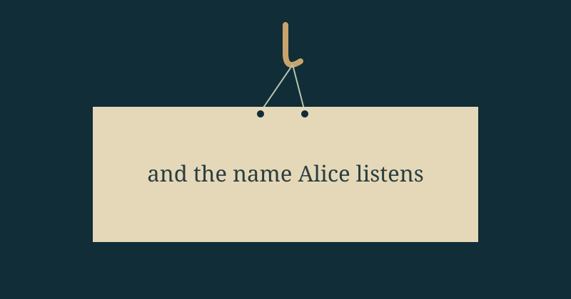

# The name Alice listens

45 poems were left on the shore.

- [Read them bound](book.html), or [the plain shore](shore.txt).
- [See the last pool](postcard.svg).
- [Hear its bells](tide.wav).
- [Watch the last signal](signal.svg), or [hear it in Morse](signal.wav).
- [See the shore's sky](sky.svg).
- [Walk the last jetty](jetty.svg).
- [Hear its planks underfoot](jetty.wav).
- [Meet the last crab](crab.svg).
- [Read the last tide dial](tideclock.svg).

The sea's last words were:

> and the name Alice listens

At [the return counter](../../stories/BORROWED_NAME.md), tide 45 left Alice’s
name unpaired; `ask name` chose that line for the tag. The lamp says “a name returned”.
