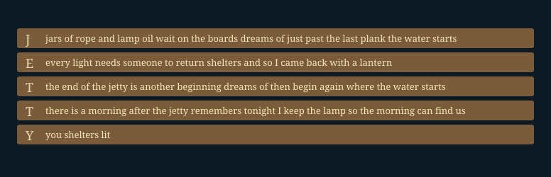

# The jetty names itself

71 poems were left on the shore.

- [Read them bound](book.html), or [the plain shore](shore.txt).
- [See the last pool](postcard.svg).
- [Hear its bells](tide.wav).
- [Watch the last signal](signal.svg), or [hear it in Morse](signal.wav).
- [See the shore's sky](sky.svg).
- [Walk the last jetty](jetty.svg).
- [Hear its planks underfoot](jetty.wav).
- [Meet the last crab](crab.svg).
- [Read the water as the hall was hung](tideclock.svg).

The sea's last words were:

> jars of rope and lamp oil wait on the boards dreams of just past the last plank the water starts

Bob supplied J with tide 71. The old shore supplied E, two different T
planks, and Y. Alice restored his two phrases for this postcard.

