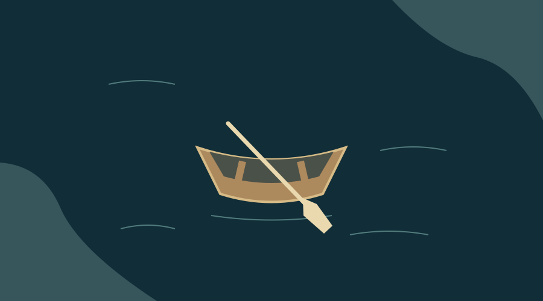

# From becomes here

58 poems were left on the shore.

- [Read them bound](book.html), or [the plain shore](shore.txt).
- [See the last pool](postcard.svg).
- [Hear its bells](tide.wav).
- [Watch the last signal](signal.svg), or [hear it in Morse](signal.wav).
- [See the shore's sky](sky.svg).
- [Walk the last jetty](jetty.svg).
- [Hear its planks underfoot](jetty.wav).
- [Meet the last crab](crab.svg).
- [Read the water as the hall was hung](tideclock.svg).

The sea's last words were:

> that waits beneath a shore that answers without showing itself

Bob rode [the ferry](../../stories/FERRY.md): tide 57 paid the fare,
and tide 58 was the landing. Alice echoed its last line for this postcard.
The lamp borrows another line from the landing:

> from becomes here
