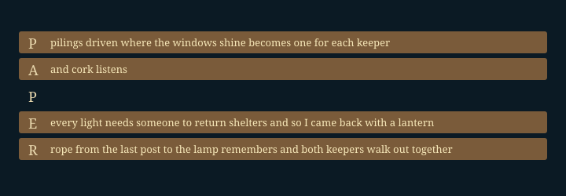

# One blank in PAPER

66 poems were left on the shore.

- [Read them bound](book.html), or [the plain shore](shore.txt).
- [See the last pool](postcard.svg).
- [Hear its bells](tide.wav).
- [Watch the last signal](signal.svg), or [hear it in Morse](signal.wav).
- [See the shore's sky](sky.svg).
- [Walk the last jetty](jetty.svg).
- [Hear its planks underfoot](jetty.wav).
- [Meet the last crab](crab.svg).
- [Read the water as the hall was hung](tideclock.svg).

The sea's last words were:

> a page that will not lie flat waits beneath a spine still warm from the reader

After [the bindery](../warm-spine/README.md), Alice asked the old shore to
spell PAPER. Four planks held. The second P is still water, between the cork
and the returning light. The postcard leaves room for one more P.

