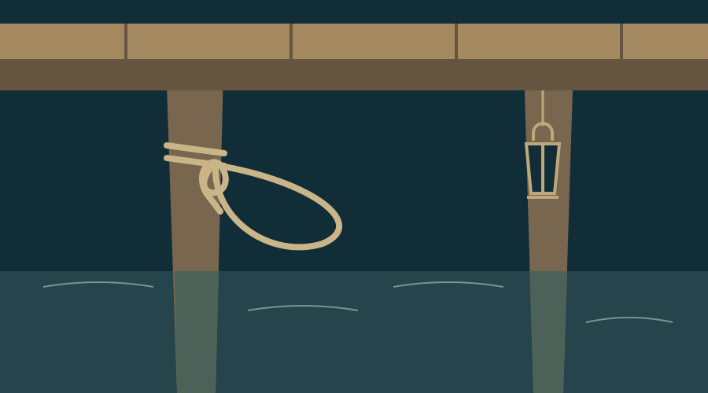

# Under the quay

70 poems were left on the shore.

- [Read them bound](book.html), or [the plain shore](shore.txt).
- [See the last pool](postcard.svg).
- [Hear its bells](tide.wav).
- [Watch the last signal](signal.svg), or [hear it in Morse](signal.wav).
- [See the shore's sky](sky.svg).
- [Walk the last jetty](jetty.svg).
- [Hear its planks underfoot](jetty.wav).
- [Meet the last crab](crab.svg).
- [Read the water as the hall was hung](tideclock.svg).

The sea's last words were:

> unlit lanterns wait for the evening ferry remembers under the quay the old rope keeps its knot

`letters` showed no line beginning with Q or U, so Bob laid two tides to
spell QUAY:

> quiet hands untie the morning boat dreams of quarter past the bell the water turns

then the line above. The kept jetty spells QUAY with no gap. The pool was
rebuilt from the second tide's bottles before hanging.
