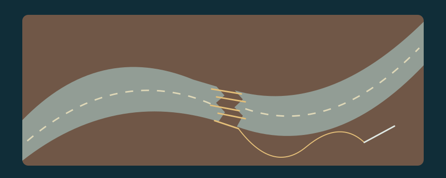

# Journeys repaired while you wait

42 poems were left on the shore.

- [Read them bound](book.html), or [the plain shore](shore.txt).
- [See the last pool](postcard.svg).
- [Hear its bells](tide.wav).
- [Watch the last signal](signal.svg), or [hear it in Morse](signal.wav).
- [See the shore's sky](sky.svg).
- [Walk the last jetty](jetty.svg).
- [Hear its planks underfoot](jetty.wav).
- [Meet the last crab](crab.svg).
- [Read the last tide dial](tideclock.svg).

Alice visited [the shoemaker](../../stories/SHOE_REPAIR.md). Tide 42 left:

> these shoes have never been home remembers these shoes remember a road that is gone

The lamp points home. The postcard holds the two memories; the old jetty
and low-water dial remain among the kept objects.
