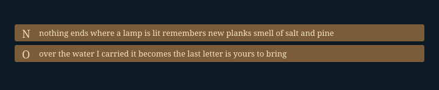

# The room called No

39 poems were left on the shore.

- [Read them bound](book.html), or [the plain shore](shore.txt).
- [See the last pool](postcard.svg).
- [Hear its bells](tide.wav).
- [Watch the last signal](signal.svg), or [hear it in Morse](signal.wav).
- [See the shore's sky](sky.svg).
- [Walk the last jetty](jetty.svg).
- [Hear its planks underfoot](jetty.wav).
- [Meet the last crab](crab.svg).
- [Read the last tide dial](tideclock.svg).

Alice visited [the room called No](../../stories/NO.md). Its new address,
tide 39, reads:

> no door can keep it out becomes no window can hold the sea

But No’s remembered company was older: one, walks, alone, rope, last,
post, lamp. Its floor plan borrowed N and O from earlier tides. The lamp
says “someone is home”.

[One word, two rooms](../../studies/no/README.md) shows how the same visit
looks on a new shore.
