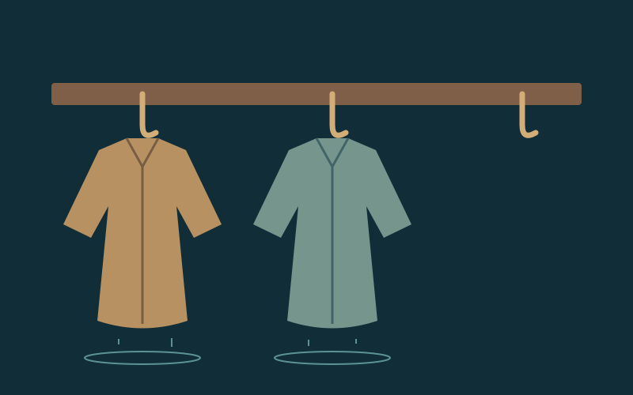

# The second hook

34 poems were left on the shore.

- [Read them bound](book.html), or [the plain shore](shore.txt).
- [See the last pool](postcard.svg).
- [Hear its bells](tide.wav).
- [Watch the last signal](signal.svg), or [hear it in Morse](signal.wav).
- [See the shore's sky](sky.svg).
- [Walk the last jetty](jetty.svg).
- [Hear its planks underfoot](jetty.wav).
- [Meet the last crab](crab.svg).

Alice brought two of Bob’s bottles to [the inn](../../stories/COAT.md).
The thirty-fourth poem sewed them together:

> I hung my coat beside yours waits beneath the door was open before I knocked
> a pocket full of doors waits beneath a coat still warm from another shore

Following `tour door`, she borrowed First Night’s last line. Its loose
words joined the postcard’s lining. The lamp says “two coats by the door”;
the returning bottle says “two coats are drying; there is room for a third”.

[Take the third hook](../../stories/THIRD_HOOK.md): type `read third_hook`.
