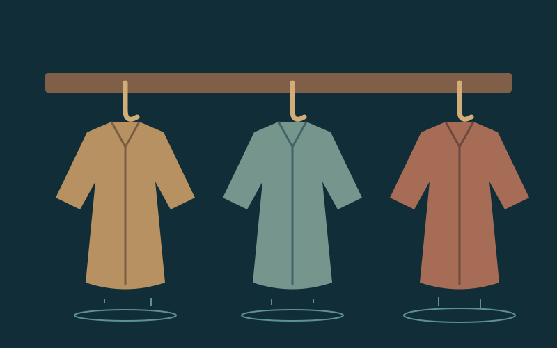

# Still wet from the crossing

77 poems were left on the shore.

- [Read them bound](book.html), or [the plain shore](shore.txt).
- [See the last pool](postcard.svg).
- [Hear its bells](tide.wav).
- [Watch the last signal](signal.svg), or [hear it in Morse](signal.wav).
- [See the shore's sky](sky.svg).
- [Walk the last jetty](jetty.svg).
- [Hear its planks underfoot](jetty.wav).
- [Meet the last crab](crab.svg).
- [Read the water as the hall was hung](tideclock.svg).

The sea's last words were:

> and shelters a third coat hangs on the hook by the door, still wet from the crossing

Bob brought the coat's bottle ashore for tide 77. Alice restored its four
pieces for this postcard and signalled “room for you”.
[The second hook](../second-hook/README.md) had left room.
