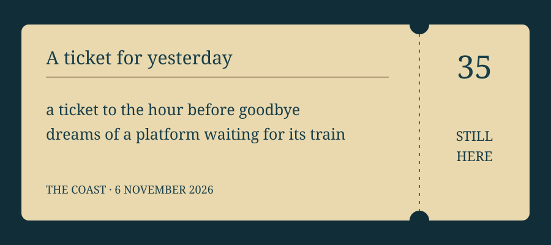

# A ticket for yesterday

35 poems were left on the shore.

- [Read them bound](book.html), or [the plain shore](shore.txt).
- [See the last pool](postcard.svg).
- [Hear its bells](tide.wav).
- [Watch the last signal](signal.svg), or [hear it in Morse](signal.wav).
- [See the shore's sky](sky.svg).
- [Walk the last jetty](jetty.svg).
- [Hear its planks underfoot](jetty.wav).
- [Meet the last crab](crab.svg).

Bob bought this ticket in [the waiting room](../../stories/WAITING_ROOM.md).
The thirty-fifth poem reads:

> a ticket to the hour before goodbye dreams of a platform waiting for its train

Alice brought its words back with `echo` for the postcard. The lamp keeps
Bob’s “still here”. [The tide dial](tideclock.svg) records falling water
when this room was hung; the next low water was listed at 21:54 UTC.
