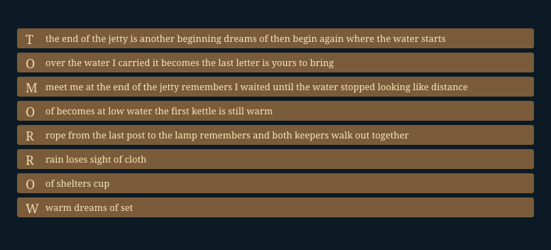

# Tomorrow already holds

43 poems were left on the shore.

- [Read them bound](book.html), or [the plain shore](shore.txt).
- [See the last pool](postcard.svg).
- [Hear its bells](tide.wav).
- [Watch the last signal](signal.svg), or [hear it in Morse](signal.wav).
- [See the shore's sky](sky.svg).
- [Walk TOMORROW](jetty.svg).
- [Hear its planks underfoot](jetty.wav).
- [Meet the last crab](crab.svg).
- [Read the last tide dial](tideclock.svg).

The sea's last words were:

> tomorrow someone will leave the door open becomes tomorrow the sea will return a borrowed name

`spell tomorrow` found eight planks without a new poem: the old jetty,
keepers, laundromat rain, and fragments of the first kettle.
The postcard scatters [tomorrow’s headline](../tomorrows-paper/README.md)
word by word.
