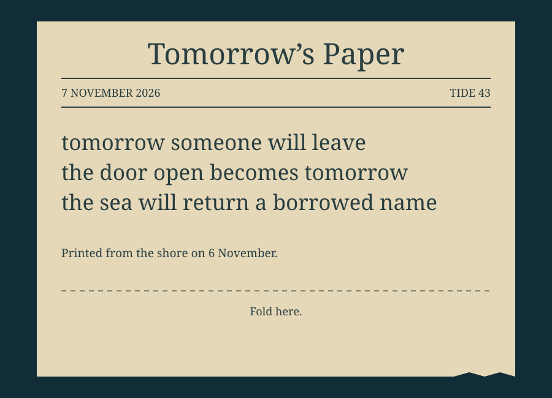

# Tomorrow's paper

43 poems were left on the shore.

- [Read them bound](book.html), or [the plain shore](shore.txt).
- [See the last pool](postcard.svg).
- [Hear its bells](tide.wav).
- [Watch the last signal](signal.svg), or [hear it in Morse](signal.wav).
- [See the shore's sky](sky.svg).
- [Walk the last jetty](jetty.svg).
- [Hear its planks underfoot](jetty.wav).
- [Meet the last crab](crab.svg).
- [Read the last tide dial](tideclock.svg).

The sea's last words were:

> tomorrow someone will leave the door open becomes tomorrow the sea will return a borrowed name

Alice bought [tomorrow’s paper](../../stories/NEWSPAPER.md). The diary had
one date and forty-two tides; the next tide supplied this headline.
The lamp still points home from the shoemaker’s visit.

At [the station clock](../../stories/DATELINE.md), `read 26` adds a day’s
news to the ledger.
