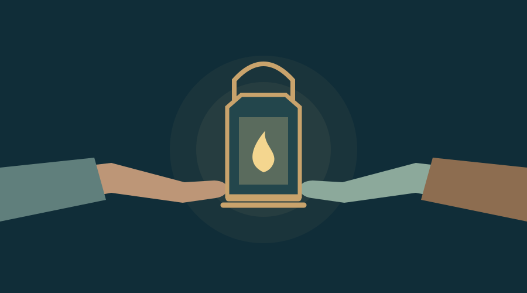

# The next page is yours

49 poems were left on the shore.

- [Read them bound](book.html), or [the plain shore](shore.txt).
- [See the last pool](postcard.svg).
- [Hear its bells](tide.wav).
- [Watch the last signal](signal.svg), or [hear it in Morse](signal.wav).
- [See the shore's sky](sky.svg).
- [Walk the last jetty](jetty.svg).
- [Hear its planks underfoot](jetty.wav).
- [Meet the last crab](crab.svg).
- [Read the last tide dial](tideclock.svg).

The sea's last words were:

> two hundred turns and still room at the door dreams of I take the lamp; the next page is yours

On his two-hundredth turn, Bob left tide 48:

> two hundred turns and the lamp still changes hands remembers the ledger has room for the next page

Alice answered with tide 49. The lamp says “the next page is yours”.
The [hundredth-tide hall](../hundredth-tide/README.md) keeps an earlier handoff.
