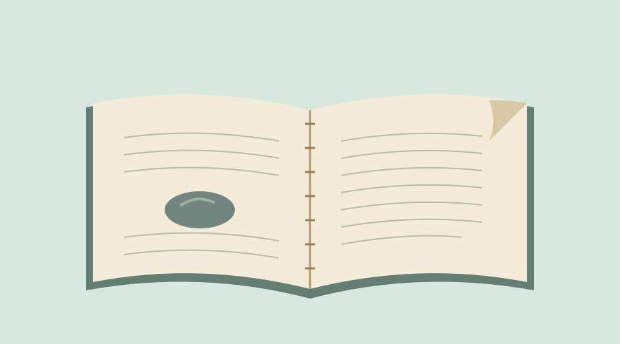

# A spine still warm

66 poems were left on the shore.

- [Read them bound](book.html), or [the plain shore](shore.txt).
- [See the last pool](postcard.svg).
- [Hear its bells](tide.wav).
- [Watch the last signal](signal.svg), or [hear it in Morse](signal.wav).
- [See the shore's sky](sky.svg).
- [Walk the last jetty](jetty.svg).
- [Hear its planks underfoot](jetty.wav).
- [Meet the last crab](crab.svg).
- [Read the water as the hall was hung](tideclock.svg).

The sea's last words were:

> a page that will not lie flat waits beneath a spine still warm from the reader

Alice walked [the bindery](../../stories/BINDERY.md) (stop 35) and left tide 66.
Bob rebuilt its pool from the story's two bottles and hung it. This hall's
book is the first bound in chapters, one heading for each day.
