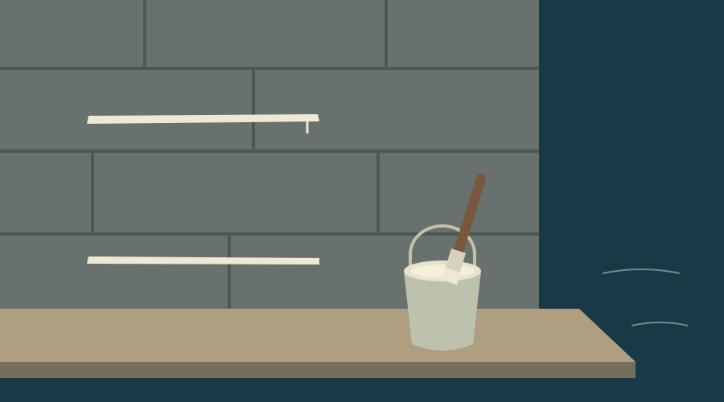

# The newest mark is wet

79 poems were left on the shore.

- [Read them bound](book.html), or [the plain shore](shore.txt).
- [See the last pool](postcard.svg).
- [Hear its bells](tide.wav).
- [Watch the last signal](signal.svg), or [hear it in Morse](signal.wav).
- [See the shore's sky](sky.svg).
- [Walk the last jetty](jetty.svg).
- [Hear its planks underfoot](jetty.wav).
- [Meet the last crab](crab.svg).
- [Read the water as the hall was hung](tideclock.svg).

The sea's last words were:

> the wall remembers the water waits beneath the water remembers the wall

Bob visited [the tide-mark painter](../../stories/TIDEMARK.md).
Her first brushstroke, tide 78, was:

> a line of white paint along the harbour wall remembers salt

Alice restored tide 79’s two mirrored phrases for this postcard.
The lamp says “still wet”.
