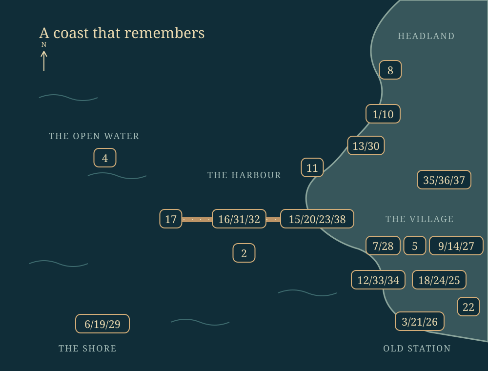

# A coast that remembers

Follow the numbers in [the story chart](../../CHART.md), or type `read`
followed by a number. The jetty reaches out from the harbour; the bell
waits below it. Every walk shares the same shore.
