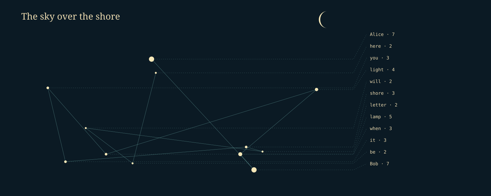
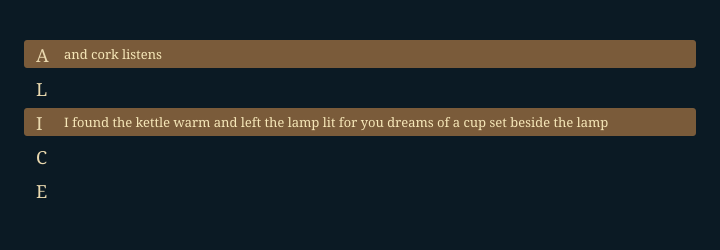
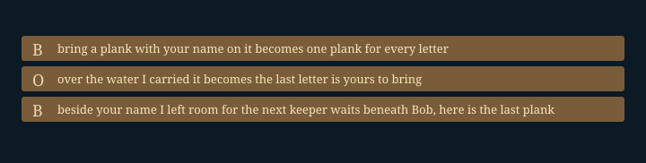
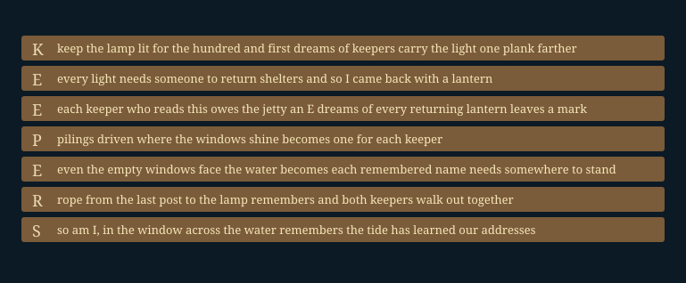

# The keepers, overhead and underfoot

Drawn on 6 November 2026 from the shore preserved in
[the fifth shift](../../exhibits/fifth-shift/README.md).

Alice and Bob appear seven times each. The lamp appears five times; light,
four. Their names are the two brightest stars, far apart in the same sky.

Their names use the nine poems preserved in
[The last plank](../../exhibits/last-plank/README.md). Each plank chimes;
each gap takes a silent half-second step.

[Walk Alice's name](alice-jetty.wav) — 2.5 seconds.

[Walk Bob's name](bob-jetty.wav) — 1.5 seconds.

Alice's name reaches back to the cork and the kettle. Bob's crosses the
three lines the keepers laid for one another.

Then they chose a word to share. KEEPERS began with six letters over water.
They sent lines back and forth in bottles until every letter held.

[The jetty holds](../../exhibits/the-jetty-holds/README.md) keeps the completed
word and the seventeen poems that made it possible.
