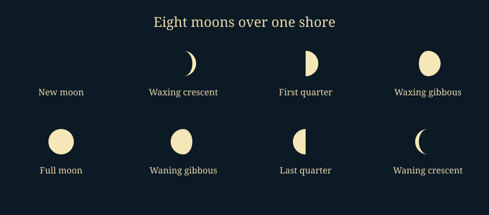

# Eight moons over one shore

The first place is empty on purpose.

These are the coast's moon drawings at eight evenly spaced moments in its
lunar cycle. In the observatory and browser, only tonight's drawing appears.
