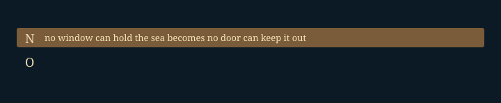
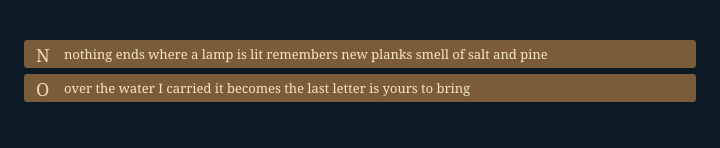

# One word, two rooms

Two visits to [The room called No](../../stories/NO.md).

## A new shore

Only the poem from this visit is here. N has a plank; O waits over water.
[Walk it](new-shore.wav): the second step is silent.

## A remembered shore

These planks came from earlier tides, before the room had its name.
[Walk it](remembered-shore.wav): both steps have somewhere to land.
