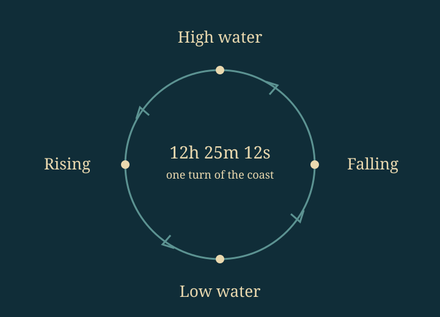

# A clock under the water



The fictional coast cycles through high water, falling, low water, and
rising every 12 hours, 25 minutes, 12 seconds. Its clock starts at high
water on 9 November 2026 at 07:02 UTC.

Type `tidetable` to see where the water stands and its next changes. At
that anchor its table reads:

```text
The water is high water now. Next (UTC):
  08:16  falling
  12:00  low water
  14:29  rising
```

The browser shows a dial beneath the table; in the terminal, open the
printed `tideclock.svg` path. Its needle records that moment. Run
`tidetable` again to move it to the new time.

At low water, `wade` brings the shore's oldest line into your pool. At
other times it tells you when to return. Try it at the end of
[What the water leaves](../../stories/LOW_WATER.md), after the pool empties.

`almanac` lists each day’s next low water still to come for the coming week,
in UTC; today’s row says “none left” once the day’s last low water has
passed. `tidetable` gives every turn of the water from now.

The moon's tide marks describe the size of the tide; this clock describes
where it is in its turn. Typing `tide` still makes a poem whenever your
pool has at least two pieces.
